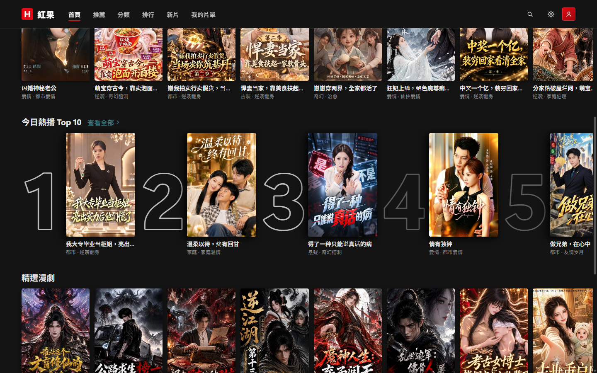
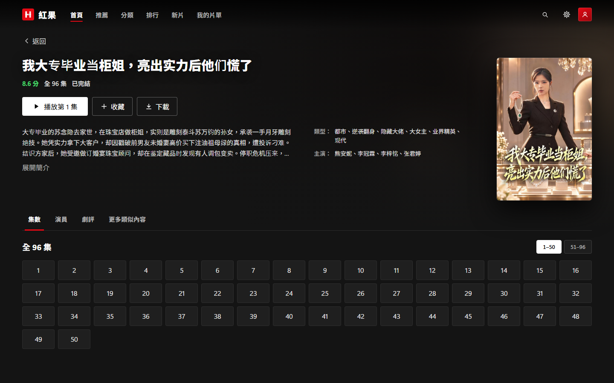
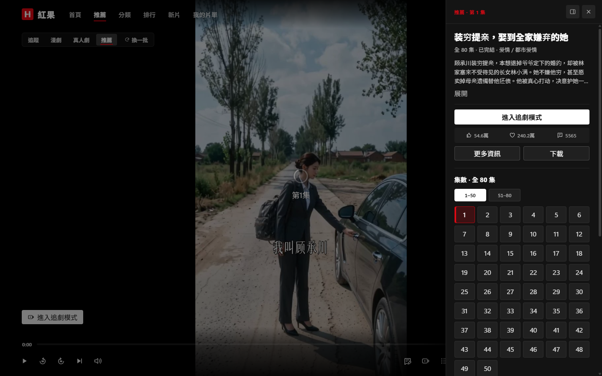

# 紅果短劇 Windows 桌面版 (Hongguo TV Desktop)

專為 Windows 桌面打造的現代化串流追劇體驗——靈感源自 Netflix 影院級暗黑視覺設計，單檔免安裝、開箱即用，支援探索刷劇、一鍵無縫追劇、批次離線快取與純鍵盤／滑鼠操控。

> 本倉庫僅用於發佈 Windows 執行檔（`.exe`）與更新說明。  
> 👉 **[立即下載最新版 Hongguo-TV.exe (v0.2.172)](https://github.com/kennynokoo/hongguo-tv-releases/releases/download/v0.2.172/Hongguo-TV.exe)** · **[查看所有 Releases](https://github.com/kennynokoo/hongguo-tv-releases/releases)**

---

## ✨ 介面預覽

### 1. 影院級滿版首頁看板
頂部滿版輪播精選推薦、漸層融合背景與高對比行動按鈕，下方無縫銜接「最新上線」與個人「繼續觀看」清單。

### 2. 今日熱播 Top 10 榜單與主題書架
大型矢量描邊排行數字搭配 2:3 俐落海報卡片，滑鼠懸停即時浮現評分、集數與快速播放鈕；橫向書架支援滑鼠滾輪與左右切換箭頭。

### 3. 劇集詳情頁與快速選集舞台
全幅氛圍光暈搭配清晰 2:3 劇集主視覺，一站瀏覽評分、總集數、演員陣容與劇評，支援區間分段跳選與整季離線下載。

### 4. 探索推薦 × 右側劇集抽屜 × 一鍵進入追劇模式
在探索頁刷到喜歡的作品時，可隨時開啟右側浮動資訊抽屜選集，或直接點擊「進入追劇模式」，無縫轉入視窗化專注播放器（免切換全螢幕即可用滾輪與 `PageUp` / `PageDown` 切換上／下一集）。

---

## 🚀 核心特色

- **現代化桌面 UI**：統一深色劇院級版面、動態縮放適配高解析度螢幕與精簡設定體驗。
- **高效率追劇操作**：
  - `Space` / `K` 播放／暫停、`J` / `L` 快退／快轉 10 秒、`←` / `→` 微調 5 秒
  - `PageUp` / `PageDown` 或滑鼠滾輪切換集數（探索頁點「進入追劇模式」立即鎖定本劇連看）
  - 滑鼠懸停音量滑桿、進度條預覽時間氣泡、`F` 切換全螢幕、支援桌面小窗置頂播放
- **智慧離線下載佇列**：支援區間批次選集與 1080P/720P 畫質選擇；遇到上游偶發異常時會自動將單集移至佇列尾端有限次重試，確保整批劇集順暢下載不卡單。
- **單檔免安裝**：內建執行環境與核心服務，雙擊 `Hongguo-TV.exe` 即可啟動，不寫入繁雜系統註冊表。

---

## 📥 快速開始

1. 前往 **[Releases 頁面](https://github.com/kennynokoo/hongguo-tv-releases/releases/latest)** 下載 `Hongguo-TV.exe`。
2. 確認系統環境為 **Windows 10 / 11 (64-bit)**（內建 Microsoft Edge WebView2 執行階段即可執行）。
3. 直接雙擊開啟，可搭配右上角個人帳號設定同步追更與觀看紀錄，或免登入直接探索瀏覽。

### 最新版本驗證資訊 (`v0.2.172`)
- **檔案**：`Hongguo-TV.exe`（`32,136,704` bytes）
- **SHA-256**：`c428da771ef9b7769d4363b690869d0915e5773c567050de02b5f79e6843f644`
